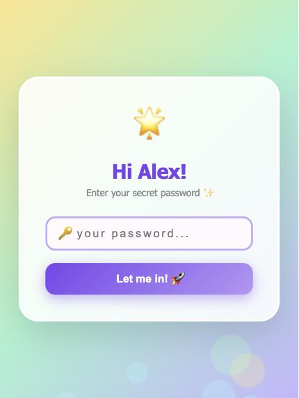
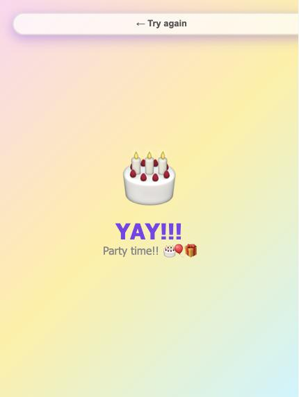
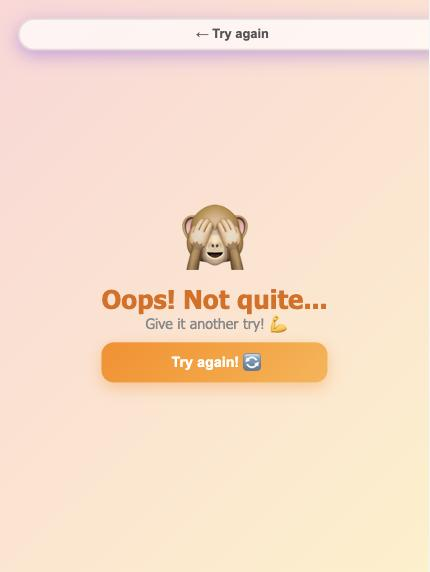

# kid-password-practice

A tiny, playful web page that helps a Pre-K/K kid practice **remembering their own password**: they type it in, and a random celebration (confetti, a cheer with their name) plays on success — nothing scary on failure, just a gentle "try again." **This is a memorization game, not a security control** — the "password" is never meant to protect anything real, so don't reuse an actual account password/PIN here.

Runs as one `nginx:alpine` container. No database, no backend, no build step — works on any machine that can run Docker: a laptop, a Raspberry Pi, a NAS (Synology/Unraid), a cloud VM, or a container manager UI (Portainer, Dockge, Coolify, Synology Container Manager, Unraid's Docker tab).

<p>
  
  
  
</p>

## Quick start

Works with Docker Compose on any platform:

```bash
git clone <this-repo-url>
cd kid-password-practice
cp .env.example .env
# edit .env: CHILD_NAME, CHILD_PASSWORD, THEME (boy/girl/neutral)
docker compose up -d
```

Open `http://<host>:8100` (or whatever `PORT` you set in `.env`).

No Compose? A plain `docker run` works too — point `--env-file` at your `.env` and bind-mount the two committed files:

```bash
docker run -d --name kid-password-practice --restart unless-stopped \
  -p 8100:80 \
  --env-file .env \
  -v "$(pwd)/index.html.template:/etc/nginx/templates/index.html.template:ro" \
  -v "$(pwd)/render-and-serve.sh:/render-and-serve.sh:ro" \
  --entrypoint sh \
  nginx:alpine /render-and-serve.sh
```

In Portainer/Unraid/Dockge, paste `docker-compose.yml`'s contents into a new stack, upload `index.html.template` and `render-and-serve.sh` alongside it, and fill in `.env` (or that platform's own environment-variable UI) the same way.

Running more than one kid's instance on the same host? Give each its own folder/`.env` (different `PORT`), and change `container_name` in `docker-compose.yml` if you copy it — only one container can hold a given name per host.

## Configuration (`.env`, never committed)

| Variable | Required | Meaning |
|---|---|---|
| `CHILD_NAME` | yes | Shown in the title and success messages |
| `CHILD_PASSWORD` | yes | What the kid practices typing |
| `THEME` | no (default: neutral) | `boy`, `girl`, or `neutral` — picks an emoji/color preset |
| `THEME_EMOJI` / `THEME_BG` / `THEME_ACCENT` | no | Override just one piece of the `THEME` preset with a custom emoji/CSS gradient/hex color |
| `PORT` | no (default: 8100) | Host port to serve on |

At startup, `render-and-serve.sh` resolves the `THEME` preset (`boy` = blue/green rocket, `girl` = pink/yellow flower, `neutral` = yellow/teal/purple star), then runs `envsubst` on `index.html.template` to produce the real page. The template (committed) only ever contains `${CHILD_NAME}` / `${CHILD_PASSWORD}` / `${THEME_EMOJI}` / `${THEME_BG}` / `${THEME_ACCENT}` placeholders — no real values live in tracked source.

After changing `.env`, re-apply with `docker compose up -d --force-recreate`.

## Putting it behind HTTPS / your own domain (optional)

The container just listens on plain HTTP (`PORT`, default `8100`). To serve it at a real hostname with TLS, put a reverse proxy in front — none of this touches the container itself.

**Caddy** (automatic HTTPS via Let's Encrypt):

```
password.example.com {
    reverse_proxy localhost:8100
}
```

**nginx:**

```nginx
server {
    listen 443 ssl;
    server_name password.example.com;

    ssl_certificate     /etc/ssl/certs/password.example.com.pem;
    ssl_certificate_key /etc/ssl/private/password.example.com.key;

    location / {
        proxy_pass http://localhost:8100;
    }
}
```

**Traefik** (as Docker labels, if you're already running a Traefik edge router):

```yaml
    labels:
      - "traefik.enable=true"
      - "traefik.http.routers.kid-password-practice.rule=Host(`password.example.com`)"
      - "traefik.http.services.kid-password-practice.loadbalancer.server.port=80"
```

Swap `localhost:8100` / `password.example.com` for your own host/port and domain. If the reverse proxy runs on a different machine than the container, use that machine's IP or hostname instead of `localhost`.

## This repo as a template

This repo is marked as a GitHub template — "Use this template" on its page creates a fresh copy with the same structure, ready for `cp .env.example .env` and your own kid's name/password/theme.

## License

[MIT](LICENSE) — use it, change it, share it.
